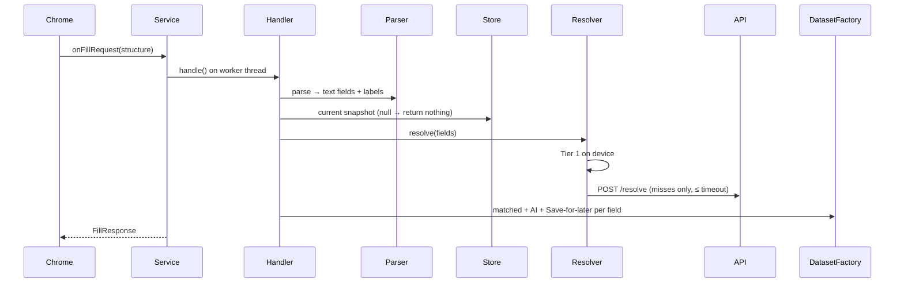

# Autofill service (Kotlin)

## Modules

```
android/
├── app/                      RN host. bridge/FillmateModule.kt = JS ↔ facade translator. No logic.
├── autofill/                 Android library
│   ├── api/                  FillmateAutofill: the ONLY entry point for :app
│   ├── service/              FillmateAutofillService (thin) → FillRequestHandler (testable)
│   ├── structure/            StructureParser, LabelExtractors (strategies), StructureDumper (spike)
│   ├── presentation/         DatasetFactory: RemoteViews dropdown + InlinePresentation
│   ├── actions/ai/           AiAnswerActivity (Compose, phase 3): S32 states
│   ├── actions/later/        SaveForLaterActivity: S33
│   ├── data/cache/           KbSnapshotStore (in-memory → Room)
│   ├── data/remote/          FillmateApi (snapshot, /resolve, /answer-ai, /fill-events)
│   ├── data/session/         SessionStore (DataStore + Tink + Keystore)
│   ├── data/events/          local queue of fill events, flushed in batches
│   ├── ui/theme/             ClayTokens.kt (GENERATED) + ClayTheme.kt (phase 3)
│   └── di/                   AutofillGraph: manual DI, one per process
└── autofill-core/            pure Kotlin: Normalizer, AliasMatcher, Resolver, models. JUnit tests.
```

## Sequences

**(a) Focus a field → suggestions**


**(b) AutoFill with AI**: user taps AI dataset → system launches `AiAnswerActivity` via the dataset's
authentication `IntentSender` (label + context in extras) → `POST /answer-ai` → state S32b/c/d → user edits →
`setResult(RESULT_OK, EXTRA_AUTHENTICATION_RESULT = Dataset(value))` → Chrome fills. Non-answers → Gap recorded.

**(c) Save for later**: tap → `SaveForLaterActivity` → enqueue gap locally → confirmation (S33) → return
without a value. Flush to `POST /gaps` when online.

**(d) History events**: our activities record what they return (AI, saved-for-later). For matched datasets the
framework's `FillEventHistory` (`getFillEventHistory()`) reports selections, but it only covers the
**last** fill response, and only for the current service. So read it at the start of each `onFillRequest`
and enqueue events before they are overwritten. Expect gaps: it is best effort. Batch to `POST /fill-events`
(also the usage meter).

## Must verify empirically (phase 1 spike, before trusting this doc)

- [ ] Which `ViewNode` fields Chrome fills for Google Forms, Greenhouse, Lever: `htmlInfo` attrs? `hint`? Is the
      question text only in a nearby non-input node? → decide `LabelExtractors` order from `StructureDumper` logs.
- [ ] Chrome setting path and name ("Autofill services" → "Autofill using another service") on the test device's Chrome version.
- [ ] Whether `autofill_service.xml` needs any `compatibility-package` entries for current Chrome (expected: no).
- [ ] Inline suggestions behavior with Gboard; dropdown fallback when inline is unavailable.
- [ ] Cold-start time of `AiAnswerActivity` over Chrome on a mid-range device (target < 400 ms to first frame).

## Timeouts and failure behavior

| Situation | Behavior |
|---|---|
| No snapshot yet (fresh install) | Return `null` (no suggestions). Onboarding triggers first sync. |
| Tier 2 timeout / offline | Tier 1 results + AI + Save-for-later. Never block. |
| Stale snapshot (`/resolve` reports a newer KB version) | Use current results; schedule `syncKb()` in the background. |
| Session dead (refresh failed) | Tier 1 still works offline; AI/Save actions show "Open Fillmate to sign in". |
| Any exception in handler | `callback.onSuccess(null)`. Log; never crash the service. |

## RN ↔ Kotlin interface

Spec: `apps/mobile/src/core/native/specs/NativeFillmate.ts` (session, KB sync/version, Playground resolve,
service status, open settings). Rule: add a bridge method only when a screen needs it, and keep the facade
the only thing the bridge calls.
