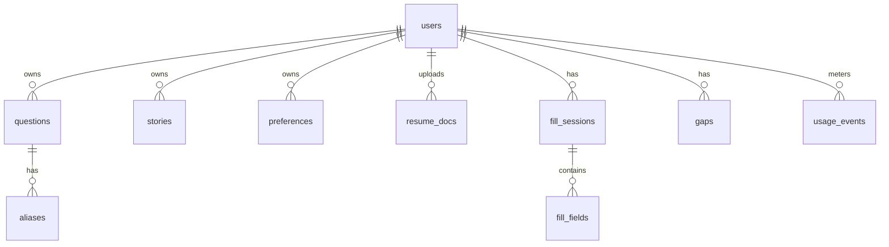

# Data model (Postgres + pgvector)

| Table | Key columns |
|---|---|
| users | id, username (unique), password_hash, plan (`free`/`premium`), kb_version (bigint), onboarded_at, settings jsonb |
| refresh_tokens | id, user_id, token_hash, family_id, used_at, expires_at (rotation + reuse detection) |
| questions | id, user_id, label, category, answer_type, answer, source (`manual`/`resume`/`gap`), updated_at |
| aliases | id, question_id, phrase, normalized (text, from rules.json), embedding vector, times_suggested, times_chosen, times_overridden_ai, last_used_at; unique(user, normalized) |
| stories | id, user_id, kind, situation, task, action, result, updated_at |
| preferences | user_id, key, value jsonb, notes |
| resume_docs | id, user_id, version, file_url, extracted_text, status, created_at |
| resume_candidates | id, resume_doc_id, label, answer, class, existing_question_id |
| fill_sessions | id, user_id, package, domain, page_title, started_at |
| fill_fields | id, session_id, label, method, question_id, alias_id, value, occurred_at |
| gaps | id, user_id, label, domain, page_title, type (`saved`/`insufficient_info`/`needs_decision`), missing, status, created_at |
| usage_events | id, user_id, kind (`autofill`/`ai_answer`), occurred_at |

Rules: every write to questions/aliases/preferences/settings bumps `users.kb_version` in the same transaction.
`aliases.normalized` is computed with the shared normalizer so uniqueness matches what the device sees.
