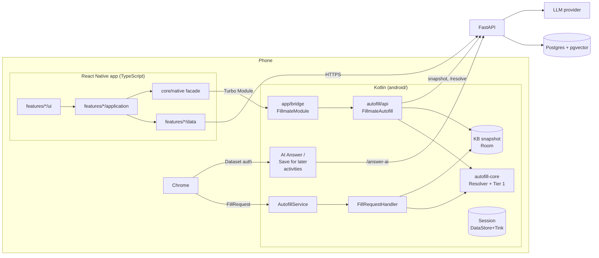

# Architecture

Fillmate fills job-application text fields from a personal answer bank. Three runtimes cooperate:
a React Native app (where the user manages answers), a Kotlin AutofillService (which Chrome talks to),
and a FastAPI backend (source of truth, semantic matching, LLM).

## 1. System view



## 2. Who owns what (the decisions everything else follows from)

| Thing | Single owner | Others access it via | Why |
|---|---|---|---|
| Answer bank (truth) | Backend Postgres | REST | Web version later needs the same data |
| On-device KB snapshot | Kotlin (Room) | `FillmateAutofill.syncKb()` from RN | Chrome can wake the service while JS is not running |
| Auth tokens + refresh | Kotlin `SessionStore` | bridge `getAccessToken` / `refreshSession` | Rotating refresh tokens break if two runtimes refresh |
| Tier 1 rules | `packages/contracts/matching/rules.json` | Kotlin + Python both read the file | Two implementations, one rule set, shared test vectors |
| Visual tokens | `packages/design-tokens/tokens.json` | generated TS + Kotlin | RN screens and Compose sheets can't drift |
| LLM model choice | Backend config | nobody | Spec: no model picker in the app |

## 3. Dependency rules (enforced, not just written down)

```
React Native:   app ──► features ──► design-system, core
                inside a feature:  ui ──► application ──► domain ◄── data
                features ──► other features ONLY via '@features/<name>' (their index.ts)
Kotlin:         :app (bridge) ──► :autofill ──► :autofill-core   (core has no Android SDK)
Backend:        routes ──► services ──► repositories ──► models;  services ──► matching, llm (ports)
```

ESLint (`apps/mobile/.eslintrc.js`) fails the build on violations; Gradle module boundaries make the
Kotlin rule a compile error. Allowed feature-to-feature edges: `onboarding → resume, importReview, chromeGuide`;
`history, gaps, playground, importReview → kb`; `gaps → stories`; `settings → auth`. No cycles.

## 4. Key flows

**Fill a known field.** Chrome → `onFillRequest` → `StructureParser` (text fields + labels) →
`Resolver`: Tier 1 alias on device, misses batched to `POST /resolve` (Tier 2, short timeout) →
`DatasetFactory` returns per field: matched answer (if any), "AutoFill with AI", "Save for later".
Nothing fills until the user taps.

**AutoFill with AI.** Tap → Dataset authentication launches `AiAnswerActivity` over Chrome →
`POST /answer-ai` (sync) → answered / insufficient_info / needs_user_decision → user edits → value
returned to Chrome. Non-answers are recorded as Gaps.

**Edit the KB.** RN screen → use-case hook → repository → REST → on success: invalidate queries **and**
`fillmateNative.kb.sync()`. Without the second step, Chrome keeps filling the old answer.

**Playground.** RN → bridge → `FillmateAutofill.resolveForPlayground` → the same `Resolver` and the same
snapshot the service uses → trace rendered as plain-language reasons (S19b) with fix actions (S19d).

## 5. Decisions and their reasons

| Decision | Alternative rejected | Reason |
|---|---|---|
| Bare React Native CLI (0.88, New Architecture) | Expo managed / prebuild | We ship a native AutofillService + Gradle modules; owning `android/` is simpler than config plugins. |
| Kotlin AutofillService, not AccessibilityService | Bitwarden-style accessibility scanning | Spec decision: per-field framework suggestions, no screen scraping permission. |
| AI Answer sheet in Compose (native) | RN screen in a second Activity | Must open instantly over Chrome; can't wait for a JS runtime cold start. Cost: clay theme exists twice, mitigated by generated tokens. |
| Manual DI (`AutofillGraph`, React context providers) | Hilt / DI containers | ~10 objects; explicit wiring is readable and teachable. |
| TanStack Query for server state, no global store | Redux / Zustand from day one | Nearly all state is server state. Add a client store only when a real need appears. |
| `minSdk 29` | 26 (Autofill minimum) | RN `boxShadow` inset (the clay look) needs Android 10. |
| No fuzzy matching in Tier 1 | Levenshtein | Wrong fills are worse than misses; misses have a cheap fix (add alias), wrong fills erode trust. |

## 6. Anti-patterns for this codebase

- Calling the LLM from `onFillRequest` (system timeout; also costs money on every focus).
- Reading or writing tokens from JS storage. Tokens live only in Kotlin.
- Copying stopwords/qualifiers into code instead of reading `rules.json`.
- Porting Stitch HTML/CSS into RN. Exports are visual references; build with design-system primitives.
- A feature importing another feature's `data/` or `ui/` directly.
- Auto-removing or auto-remapping aliases. The app shows insights; the user decides.
